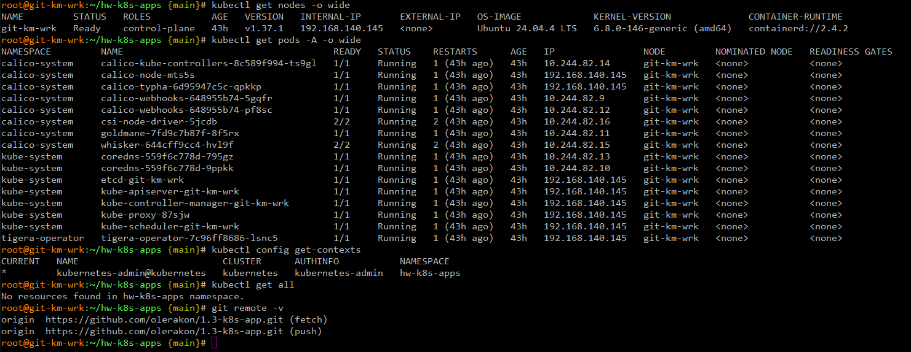
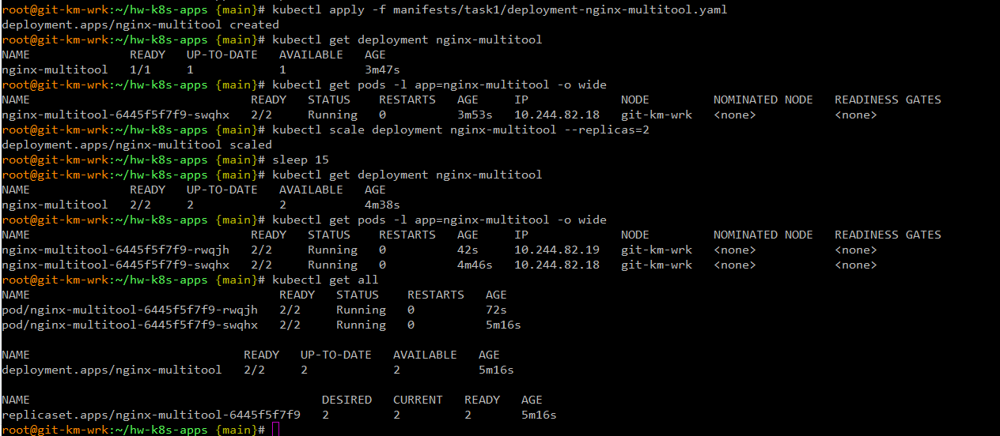
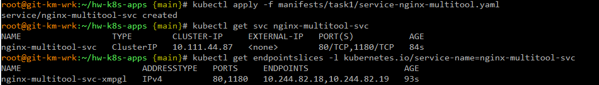
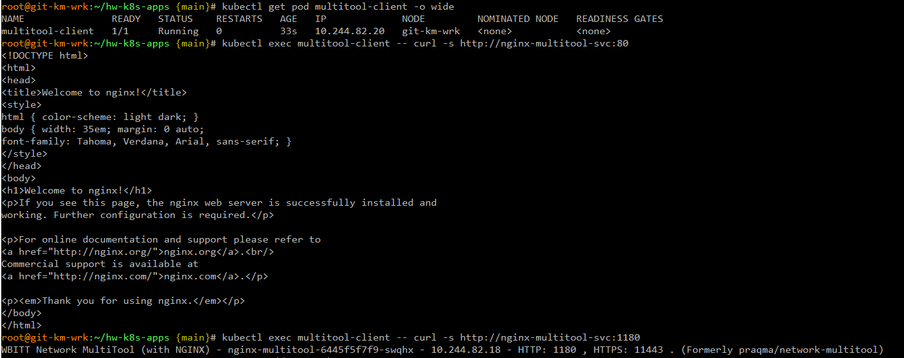
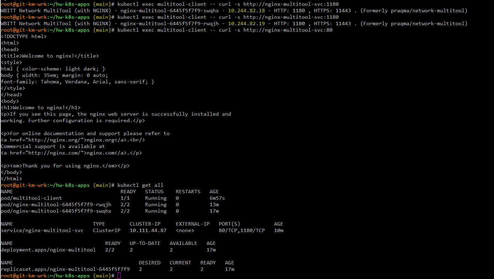
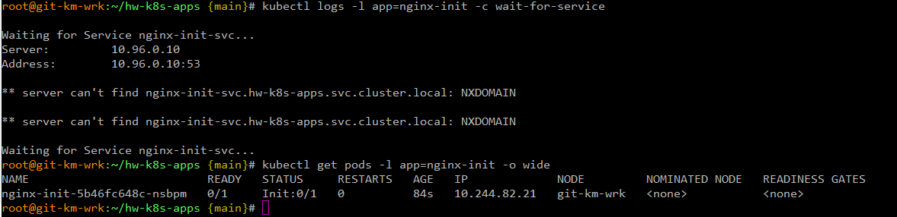

# Домашнее задание к занятию «Запуск приложений в K8S» - `Гилельс Кирилл`

------

## Предварительная информация

На VM Ubuntu 24.04 LTS был развернут полноценный kubernetes версии 1.37.1 в формате all-in-one-single-node средствами kubeadm.
IP адресс машины 192.168.140.145
В качестве сетевого плагина был выбран calico. Network cidr: 10.244.0.0/16
Так же был инициализирован гит репозиторий проекта https://github.com/olerakon/1.3-k8s-app
Для домашнего задания был создан отдельный ns: `hw-k8s-apps` и настроена дефолтная работа в нем через kubectl.

Сводная информация представлена на скриншоте:
(Примечание: было желание выполнять блок по домашнему заданию на мощностях тестового кластера из 6 нод под управлением ранчера, внутри компании, однако в виду сетевых ограничений, осложнений в ввиде проксирования образов через нексус, развернутых тестовых сред с занятыми портами, пришлось делать отдельную сингл ноду *грусть-печаль-тоска-беда*)

------

## Задание 1. Создать Deployment и обеспечить доступ к репликам приложения из другого Pod

1. Создать Deployment приложения, состоящего из двух контейнеров — nginx и multitool. Решить возникшую ошибку.
2. После запуска увеличить количество реплик работающего приложения до 2.
3. Продемонстрировать количество подов до и после масштабирования.
4. Создать Service, который обеспечит доступ до реплик приложений из п.1.
5. Создать отдельный Pod с приложением multitool и убедиться с помощью `curl`, что из пода есть доступ до приложений из п.1.

------

### Решение 

1. Согласно архитектуре Kubernetes, все контейнеры внутри одного Pod разделяют общее сетевое пространство (Network Namespace) и используют один IP-адрес и стек портов. Так как multitool по умолчанию слушает порты 80 и 443, а nginx 80, то с nginx возникнет конфликт портов. 
Разработчики образа wbitt/network-multitool предусмотрели встроенный механизм кастомизации. Внутри контейнера инициализационный скрипт считывает переменные окружения HTTP_PORT и HTTPS_PORT.
Если эти переменные переданы, скрипт перед стартом веб-сервера автоматически перезаписывает конфигурационные файлы nginx внутри multitool, меняя стандартные порты (80 и 443).

Решение — задать HTTP_PORT=1180 и HTTPS_PORT=11443 для multitool.

Прикладываю манифест deployment [deployment-nginx-multitool.yaml](./manifests/task1/deployment-nginx-multitool.yaml)

2. Было увеличено число реплик с 1 до 2.
3. Прикладываю число подов, а так же исполняемые команды.

4. Был создан сервис для доступа к репликам по 80 порту.

Манифест сервиса [service-nginx-multitool.yaml](./manifests/task1/service-nginx-multitool.yaml)

5. Был создан отдельный под multitool client для доступа к приложениям.

Манифест пода [spod-multitool-client.yaml](./manifests/task1/pod-multitool-client.yaml)

Итоговая пачка скриншотов по сервису и поду и проверкам:

------

## Задание 2. Создать Deployment и обеспечить старт основного контейнера при выполнении условий

1. Создать Deployment приложения nginx и обеспечить старт контейнера только после того, как будет запущен сервис этого приложения.
2. Убедиться, что nginx не стартует. В качестве Init-контейнера взять busybox.
3. Создать и запустить Service. Убедиться, что Init запустился.
4. Продемонстрировать состояние пода до и после запуска сервиса.

------

### Решение

1. Init-контейнер busybox ждёт появления DNS-имени Service. Пока Service нет, основной nginx не стартует; это стандартный сценарий ожидания Service через nslookup.

Прикладываю манифест deployment [deployment-nginx-init.yaml](./manifests/task2/deployment-nginx-init.yaml)

2. Убедился что под в статусе INIT 

3. Создал сервис. 

Прикладываю манифест сервиса  [service-nginx-init.yaml](./manifests/task2/service-nginx-init.yaml)

4. Итоговая демонстрация.

------

### Правила приема работы

1. Домашняя работа оформляется в своем Git-репозитории в файле README.md. Выполненное домашнее задание пришлите ссылкой на .md-файл в вашем репозитории.
2. Файл README.md должен содержать скриншоты вывода необходимых команд `kubectl` и скриншоты результатов.
3. Репозиторий должен содержать файлы манифестов и ссылки на них в файле README.md.

------